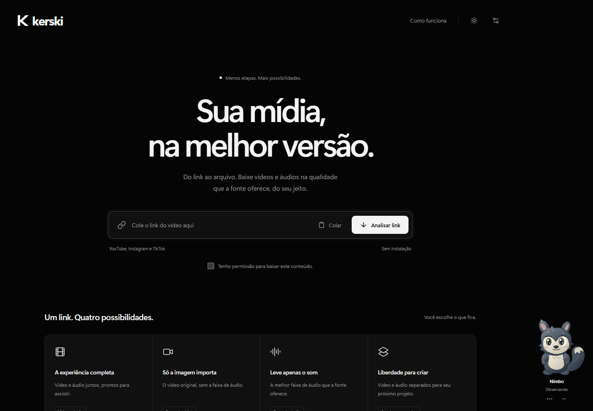
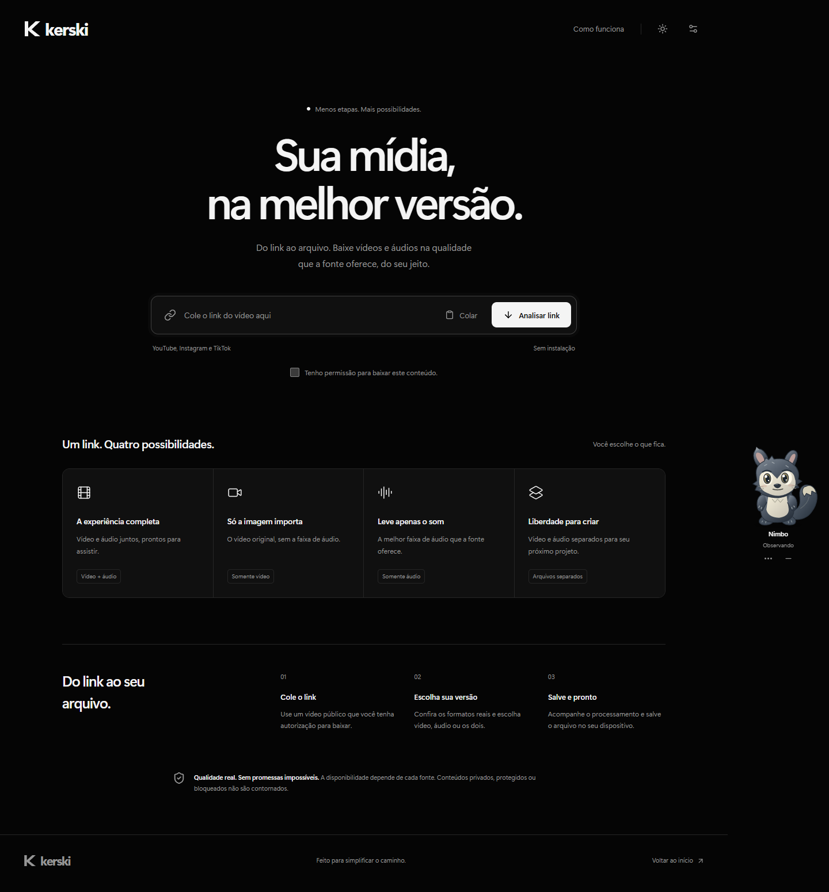
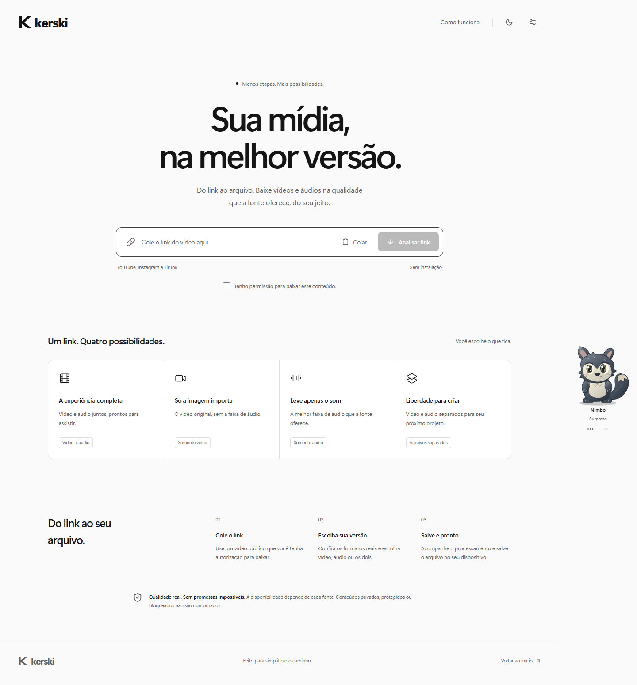
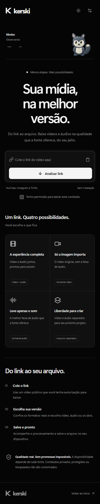
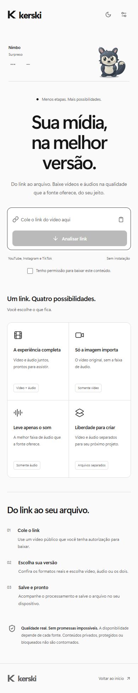
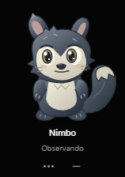
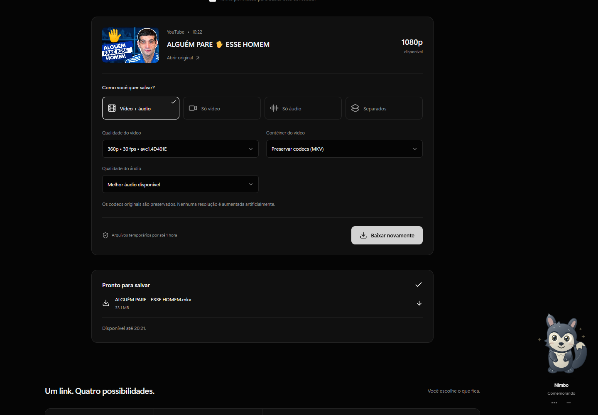
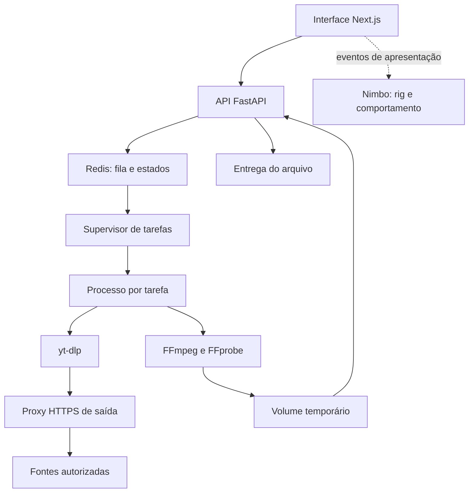

<div align="center">

# Kerski

**Sua mídia, na melhor versão.**

Análise, download e processamento de mídia autorizada, com uma interface discreta e um pequeno companheiro chamado Nimbo.

[Interface](#interface) · [Funcionalidades](#funcionalidades) · [Nimbo](#nimbo-o-companheiro-do-kerski) · [Instalação](#executar-localmente) · [Testes](#testes-e-validação)

</div>



> **Versão 0.1 — em validação.** O projeto contém extração e processamento reais. Um vídeo autorizado do YouTube foi baixado e processado em 1080p/60 fps. A execução completa em Docker, o suporte real a Instagram/TikTok e os requisitos de operação pública ainda precisam de validação. Publicar este repositório não significa que o aplicativo já esteja hospedado ou pronto para produção.

## Sobre o projeto

O Kerski concentra o caminho entre um link e um arquivo em uma única página: informar a URL, consultar os formatos que a fonte realmente oferece, escolher o que salvar e acompanhar a tarefa até o arquivo ficar disponível.

A proposta combina qualidade de mídia, simplicidade e identidade visual própria. O modo automático procura a maior resolução disponível, preserva codecs quando possível e não apresenta upscale como qualidade nativa. O backend executa o trabalho pesado fora da interface, com fila, armazenamento temporário e limites operacionais.

O **Nimbo** é um personagem original integrado à experiência. Ele observa, descansa e reage aos eventos do aplicativo, sem falar, bloquear o fluxo ou controlar downloads.

## Interface

As imagens são capturas reais da aplicação. O design usa preto profundo, superfícies discretas, controles compactos e preferência de tema persistida localmente.

### Desktop

<details>
<summary>Página completa no tema escuro</summary>



</details>

<details>
<summary>Página completa no tema claro</summary>



</details>

### Celular

<p align="center">
  
  
</p>

No celular, os controles se reorganizam e o pet ocupa uma área própria no fluxo da página. No desktop, uma faixa lateral mantém o personagem fora da área dos botões principais.

## Funcionalidades

| Recurso | Comportamento |
| --- | --- |
| Análise de URL | Valida o endereço, identifica a plataforma e consulta metadados reais. |
| Formatos disponíveis | Mostra resoluções, FPS, codecs e faixas de áudio retornados pela fonte. |
| Qualidade automática | Prioriza resolução e taxa de quadros, sem teto artificial de 1080p. |
| Vídeo + áudio | Une os fluxos sem recodificação; MKV por padrão, MP4 quando compatível. |
| Somente vídeo | Remove o áudio e preserva o codec de vídeo. |
| Somente áudio | Preserva o codec em MKA ou converte para M4A, MP3, Opus, WAV ou FLAC. |
| Arquivos separados | Entrega vídeo e áudio individualmente, com opção adicional de ZIP. |
| Tarefas assíncronas | Fila, consulta de estado, cancelamento e tratamento de falhas. |
| Progresso real | Bytes e velocidade medidos; percentual apenas com tamanho conhecido. |
| Arquivos temporários | Retenção limitada e exclusão automática pelo worker. |
| Aparência | Temas escuro, claro e sistema, com preferência local. |
| Acessibilidade | Labels, foco visível, teclado e suporte a movimento reduzido. |
| Pet interativo | Nimbo com rig, comportamento, interações e preferências locais. |

Converter uma fonte comprimida para WAV ou FLAC não recupera detalhes perdidos. Qualidade e disponibilidade dependem da fonte; um formato não encontrado não é exibido como opção real.

### Plataformas

| Plataforma | Situação |
| --- | --- |
| YouTube | Análise, download e quatro modalidades testados com um vídeo autorizado. Não é garantia de compatibilidade universal. |
| YouTube Shorts | URLs reconhecidas e extrator configurado; sem teste real separado de Shorts. |
| Instagram Reels e vídeos | URLs reconhecidas e extrator configurado; teste real autorizado pendente. |
| TikTok | URLs reconhecidas e extrator configurado; teste real autorizado pendente. |

Lives, playlists, fontes sem duração conhecida e conteúdo que exige autenticação não fazem parte do suporte atual. Não há importação de cookies, desbloqueio de DRM ou remoção de marcas-d'água incorporadas. Use apenas conteúdo próprio ou autorizado.

## Nimbo, o companheiro do Kerski

<p align="center"></p>

O Nimbo é um pequeno mustelídeo imaginário, com pelagem grafite, focinho claro, orelhas assimétricas, olhos âmbar e cauda larga com ponta de fita. Foi desenhado em vetores para este projeto; não utiliza modelo de personagem ou GIF pronto.

São nove estados: **idle, curioso, feliz, animado, confuso, triste, sonolento, surpreso e brincalhão**. As poses combinam respiração, piscadas variáveis, olhar limitado, orelhas, braços, pés e cauda, antecipação de saltos e recuperação após cada ação.

O motor interpola poses de um rig SVG, com curvas faciais e articulações atualizadas diretamente. Não aplica apenas uma transformação CSS ao desenho inteiro. O loop é limitado a 30 fps e não provoca uma renderização React a cada frame.

| Interação | Reação |
| --- | --- |
| Colar link / iniciar análise | Curiosidade e atenção. |
| Identificar vídeo | Satisfação breve. |
| Download ou processamento | Postura atenta e movimento discreto. |
| Conclusão | Comemoração curta. |
| Link inválido / falha | Confusão / tristeza discreta. |
| Mudança de tema | Surpresa com a iluminação. |
| Clique, toque, Enter ou Espaço | Reação variável, com comemoração rara. |
| Cursor suave sobre o pet | Carinho. |
| Arrasto | Deslocamento limitado à área segura, com posição persistida. |
| Inatividade | Cochilo após cerca de 50 segundos. |

O menu de três pontos, ou botão direito sobre o personagem, permite escolher tamanho e pelagem, reduzir animações, habilitar som, restaurar posição ou ocultar. Também é possível minimizar. Para reativá-lo depois de ocultar: **Configurações → Mostrar Nimbo**.

Os sons são breves, sintetizados e **desativados por padrão**. Mesmo quando habilitados, só são produzidos ao tocar diretamente no personagem; não há reprodução automática em downloads. As preferências ficam em `localStorage`, sem envio a um servidor.

O Nimbo também foi verificado em um download real pela interface: um arquivo de 360p/30 fps foi recebido e a conclusão acionou sua comemoração. API e processamento foram reais; o armazenamento de fila usou FakeRedis nesse ensaio. Veja o [registro do teste](VALIDACAO-NIMBO.json).

<details>
<summary>Captura do download real concluído</summary>



</details>

O módulo tem carregamento separado, pausa em abas ocultas e elimina o loop contínuo quando movimento reduzido está ativo. A adaptação móvel foi testada em Chromium com viewport de celular; medições em aparelhos físicos intermediários continuam pendentes. Veja [NIMBO.md](NIMBO.md).

## Tecnologias

| Camada | Tecnologias |
| --- | --- |
| Interface | Next.js 16.4.3, React 19.3.1, TypeScript, Tailwind CSS 4, Lucide e botão composto com variantes/Slot no padrão shadcn/ui. |
| Pet | SVG original, rig procedural em TypeScript, eventos tipados, `requestAnimationFrame` e Web Audio opcional. |
| API | Python 3.12, FastAPI e Pydantic. |
| Extração | yt-dlp com EJS e Node.js no container. |
| Mídia | FFmpeg para remux/conversão; FFprobe para inspeção. |
| Fila | Redis e supervisor com processo separado por tarefa. |
| Infraestrutura | Docker Compose, rede interna, proxy HTTPS e volumes temporários. |
| Testes | pytest, FakeRedis, mídia sintética e Playwright. |

As versões JavaScript estão em `frontend/package-lock.json`. As versões Python usadas na validação estão em `backend/requirements-tested.txt`, aplicadas como constraints no build.

## Arquitetura



O navegador não recebe comandos nem URLs assinadas de streams. O worker consulta novamente a fonte ao baixar e valida a seleção. O pet escuta eventos de apresentação; não acessa a fila nem pode iniciar ou cancelar tarefas.

```text
kerski/
├── frontend/
│   ├── app/                    # Página, estilos, layout e ícone
│   ├── components/ui/          # Componentes compartilhados
│   ├── components/pet/         # Desenho, rig, comportamento e eventos
│   ├── tests/                  # Playwright: fluxos, pet e capturas
│   └── Dockerfile
├── backend/
│   ├── kerski/
│   │   ├── api.py              # Endpoints e entrega
│   │   ├── media.py            # Formatos, download, remux, áudio e ZIP
│   │   ├── security.py         # URLs, destinos e nomes
│   │   ├── models.py           # Entradas e estados
│   │   ├── store.py            # Redis e retenção
│   │   └── worker.py           # Supervisor, limites e limpeza
│   ├── tests/
│   └── Dockerfile
├── infra/egress.py             # Proxy de saída
├── previews/                   # Capturas reais
├── compose.yaml
├── ARQUITETURA.md
├── INSTALACAO.md
├── NIMBO.md
└── VALIDACAO.md
```

## Executar localmente

### Conjunto completo com Docker

Requisitos: Git, Docker Engine/Desktop com Compose, internet e pelo menos 10 GB livres.

```sh
git clone https://github.com/nivek45/Kerski.git
cd Kerski
docker compose up --build
```

Abra **http://localhost:3000**. Somente a interface é exposta em loopback; API e Redis ficam na rede interna.

```sh
docker compose ps
docker compose logs -f api worker
# Encerrar preservando volumes:
docker compose down
```

**Limite de validação:** o host de implementação não tinha Docker/WSL. A configuração está preparada, mas a execução integral e o isolamento devem ser conferidos antes de publicar o aplicativo.

### Desenvolvimento da interface

Com Node.js 24 e npm:

```sh
cd frontend
npm ci
npm run dev
```

Sem os serviços de mídia, é possível trabalhar na interface e no pet, mas analisar/baixar retorna indisponibilidade. Não existe fallback silencioso com formatos simulados. `API_ORIGIN` define o destino interno do proxy `/api`; o padrão é `http://127.0.0.1:8000`.

### API

| Método e caminho interno | Finalidade |
| --- | --- |
| `GET /health` | Redis e heartbeat do worker. |
| `POST /analyses` | Criar análise autorizada. |
| `POST /downloads` | Criar tarefa com modalidade e formatos. |
| `GET /jobs/{id}` | Estado, progresso e arquivos. |
| `POST /jobs/{id}/cancel` | Solicitar cancelamento. |
| `GET /jobs/{id}/files/{index}` | Receber arquivo pronto. |

Pela interface, os caminhos recebem `/api`. Estados: `queued`, `analyzing`, `downloading`, `processing`, `ready`, `failed`, `canceled` e `expired`. Arquivos expirados respondem HTTP 410.

## Configuração e limites

| Variável | Padrão / finalidade |
| --- | --- |
| `API_ORIGIN` | `http://api:8000` no Compose. |
| `REDIS_URL` | `redis://redis:6379/0` no Compose. |
| `MEDIA_ROOT` | `/data` no Compose. |
| `MEDIA_PROXY` | `http://egress:8888`; obrigatório para o extrator. |
| `RETENTION_SECONDS` | `3600`: uma hora desde a criação da tarefa. |
| `MAX_BYTES` | `2147483648`: 2 GiB por tarefa. |
| `MAX_DURATION` | `7200`: até duas horas de vídeo. |
| `MAX_STORAGE_BYTES` | Orçamento global padrão de 10 GiB. |
| `FFMPEG_BINARY` / `FFPROBE_BINARY` | Caminhos opcionais dos executáveis. |

Uma tarefa é executada por vez, com fila de até 30 itens. Limites: 120 segundos para análise e 20 minutos para download/processamento. Rate limit: 10 análises e 5 downloads por minuto por endereço direto recebido pela API. Atrás do Next.js esse limite é compartilhado; uma implantação pública exige limites por usuário/IP na borda.

O worker remove arquivos expirados. Se estiver parado, eles deixam de ser servidos, mas aguardam a retomada para remoção física. O volume de produção também precisa de quota física.

## Testes e validação

[VALIDACAO.md](VALIDACAO.md) separa testes automatizados, reais e pendências. O teste autorizado de YouTube gerou H.264/AAC com **1920×1080, 60 fps e 621,993 segundos**, confirmado por FFprobe. Veja o [registro](VALIDACAO-YOUTUBE.json).

### Backend

```sh
cd backend
python -m venv .venv
```

Ative com `.venv\Scripts\Activate.ps1` no PowerShell ou `source .venv/bin/activate` no Linux/macOS:

```sh
python -m pip install -r requirements-dev.txt -c requirements-tested.txt
python -m pytest -q
```

A suíte validada tem **62 testes**. A mídia é gerada localmente e os testes de estado/fila usam FakeRedis. Isso não substitui a validação operacional de Redis e containers reais.

### Interface e pet

```sh
cd frontend
npm ci
npx playwright install chromium
npm run test:e2e
npm run typecheck
npm run build
```

`PLAYWRIGHT_EXECUTABLE_PATH` pode apontar para um Chrome instalado. A suíte validada contém **30 testes de navegador** em desktop e viewport móvel. Os testes cobrem quatro modos, erros, cancelamento, temas, layout móvel, pet, persistência, arrasto, repouso e pausa. As respostas de plataforma são substituídas por fixtures somente nos testes de interface.

## Segurança e uso responsável

- HTTPS com hosts/caminhos reconhecidos, sem credenciais embutidas ou portas alternativas.
- Proxy que rejeita IPs privados, loopback, link-local e respostas DNS mistas, conectando ao IP verificado.
- Worker em rede interna no Compose, sem saída direta para internet.
- FFmpeg/FFprobe com argumentos separados, sem interpolação em shell.
- Caminhos verificados, nomes sanitizados, limites de tempo/tamanho e concorrência.
- IDs aleatórios de 256 bits como credenciais temporárias: quem tem o endereço acessa a tarefa até expirar.
- Sem desbloqueio de DRM, autenticação de plataformas ou promessa de suporte universal.

Antes de expor a aplicação, valide o Compose e configure TLS, proteção de borda, cotas, monitoramento e autenticação conforme o uso. Esses mecanismos não equivalem a uma auditoria independente.

## Próximos passos

- [x] Interface responsiva, temas e quatro modalidades de mídia.
- [x] Download real de um vídeo autorizado do YouTube.
- [x] Remux, conversões, arquivos separados e ZIP.
- [x] Nimbo original, rig, comportamento e preferências.
- [ ] Validar o fluxo completo com Redis e Docker.
- [ ] Testar falhas, reinício e cancelamento de processos no Linux.
- [ ] Validar Instagram, TikTok e Shorts com conteúdo autorizado.
- [ ] Medir carga, acessibilidade e desempenho em dispositivos físicos.
- [ ] Preparar hospedagem pública, autenticação e limites por usuário.

## Documentação

- [Arquitetura e pesquisa](ARQUITETURA.md)
- [Guia operacional](INSTALACAO.md)
- [Conceito e implementação do Nimbo](NIMBO.md)
- [Relatório de validação](VALIDACAO.md)

As dependências mantêm suas próprias licenças. Este repositório não inclui vídeos baixados, credenciais ou uma licença de redistribuição definida para o código original.
